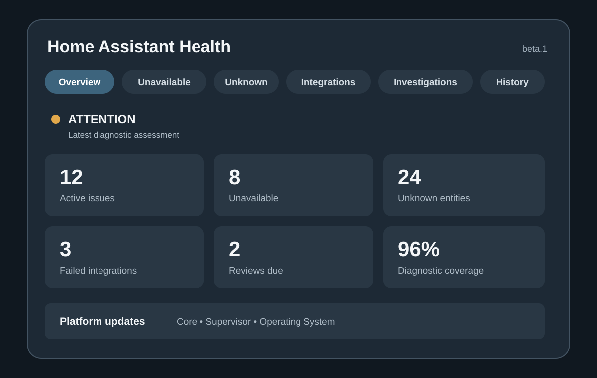

# Home Assistant Health Manager Card



A standalone Lovelace card for the [Home Assistant Health Manager](https://github.com/kraroed/home-assistant-health-manager) integration.

The card reads the integration's consolidated **Health Overview** sensor and presents its data in six responsive views:

- **Overview** — overall status, issue counts, platform updates, compatibility, diagnostic coverage, and diagnostic report verification (file existence, readability, size, modification time, and path).
- **Unavailable** — current and persistent outages, evidence-based groups, missing entities, and affected entity IDs.
- **Unknown** — raw and actionable unknown counts, saved classification totals, domain counts, and reviews due.
- **Integrations** — failed integrations, attention domains, and integration state information.
- **Investigations** — unavailable investigation records, status counts, evidence, notes, and affected entities.
- **History** — recent availability events when the optional history sensor is configured.

This is a display card. It does not automatically classify entities, suppress alerts, dismiss investigations, or change investigation statuses.

## Requirements

- Home Assistant with Lovelace.
- The Home Assistant Health Manager integration installed and configured.
- The integration's Health Overview sensor available.

## Install with HACS

1. Open **HACS → ⋮ → Custom repositories**.
2. Add `kraroed/lovelace-home-assistant-health-manager-card`.
3. Choose **Dashboard** as the category.
4. Install **Home Assistant Health Manager Card**.
5. Refresh the browser after installation.

## Add the card

Add a Manual card to your dashboard:

```yaml
type: custom:home-assistant-health-manager-card
entity: sensor.health_overview
title: Home Assistant Health
```

If your Health Overview entity has a different entity ID, use the exact ID shown under **Settings → Devices & services → Entities**.

### History sensor

The card uses `sensor.unavailable_entity_history_events` by default to display retained availability events. If you renamed that entity, override it with the exact entity ID from your installation:

```yaml
type: custom:home-assistant-health-manager-card
entity: sensor.health_overview
history_entity: sensor.your_unavailable_entity_history_events
```

### Report verification sensor

The Overview reads `sensor.diagnostic_report_verification` by default. If Home Assistant assigned a different entity ID or you renamed it, set `report_verification_entity`:

```yaml
type: custom:home-assistant-health-manager-card
entity: sensor.health_overview
report_verification_entity: sensor.your_diagnostic_report_verification
```

## Notes

- All six views use the Health Overview sensor attributes, so the card does not need a separate entity configured for every metric.
- The History view can show the retained event count without the optional history sensor; the event list requires that sensor.
- When `sensor.diagnostic_report_verification` is available, the Overview displays its verification status and report-file metadata. Recorder overflow is described as preserved only when the integration reports a verified archive; existing but corrupt, unreadable, or incomplete files are clearly distinguished from missing files.
- If the report-verification sensor is unavailable, the card explicitly shows that verification is unavailable and does not infer preservation from a stored file path.
- Grouping is an association lead based on available evidence, not confirmation of a shared root cause.
- Investigation statuses such as **Expected** and **Resolved** are user-managed tracking labels. They do not change availability counts or entity classifications.
- The card is read-only in this initial beta release.

## Development

The card is a dependency-free custom element in `health-manager-card.js`. No build step is required.
